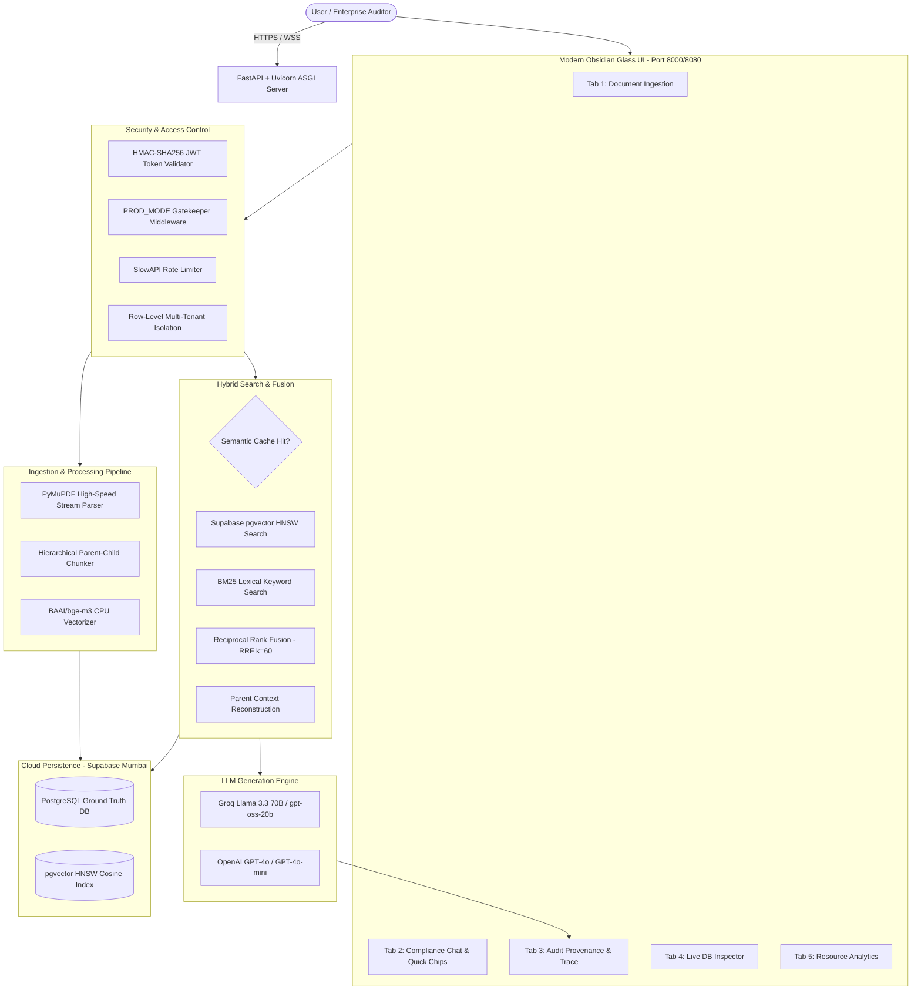

# 📘 Engineering Knowledge Transfer (KT) Handbook
## Enterprise Document Intelligence & Compliance Audit RAG Engine

> **Target Audience:** Junior Developers, New Team Joiners, and Solution Architects  
> **Repository:** `EThack`  
> **Last Updated:** October 2026  
> **Primary Maintainer:** AI & Architecture Engineering Team

---

## 📑 Table of Contents
1. [Executive Summary & Purpose](#1-executive-summary--purpose)
2. [End-to-End System Architecture](#2-end-to-end-system-architecture)
3. [Deep-Dive: Ingestion & Hierarchical Chunking](#3-deep-dive-ingestion--hierarchical-chunking)
4. [Embedding Intelligence: BAAI/bge-m3](#4-embedding-intelligence-baaibge-m3)
5. [Storage Architecture: Supabase PostgreSQL + pgvector](#5-storage-architecture-supabase-postgresql--pgvector)
6. [Retrieval Science: Hybrid Dense + BM25 + RRF](#6-retrieval-science-hybrid-dense--bm25--rrf)
7. [In-Engine Semantic Cache (<10ms Retrieval)](#7-in-engine-semantic-cache-10ms-retrieval)
8. [Multi-Tenant Security, JWT Auth & Data Isolation](#8-multi-tenant-security-jwt-auth--data-isolation)
9. [BYOK Dynamic Model Routing & Context Window Budgeting](#9-byok-dynamic-model-routing--context-window-budgeting)
10. [Frontend UI Architecture (Obsidian Glass 2026)](#10-frontend-ui-architecture-obsidian-glass-2026)
11. [Scalability: Handling 5,000+ Page Documents](#11-scalability-handling-5000-page-documents)
12. [DevOps: Containerization & GCP Cloud Run Deployment](#12-devops-containerization--gcp-cloud-run-deployment)
13. [Codebase Directory Sitemap & Onboarding Guide](#13-codebase-directory-sitemap--onboarding-guide)

---

## 1. Executive Summary & Purpose

### The Business Problem
Enterprise organizations, financial institutions, and legal teams manage vast libraries of regulatory circulars, contracts, compliance frameworks, and audit manuals ranging from **50 to 5,000+ pages**. 
Standard search engines and generic AI chatbots suffer from three fatal flaws when applied to enterprise documents:
1. **Hallucination Risk:** Generative models invent citations or misquote regulatory clauses.
2. **Context Fragmentation:** Standard fixed-size chunking (e.g., 200 words) cuts sentences in half, severing statutory definitions from their operational obligations.
3. **Keyword Blindness:** Pure semantic vector search frequently misses exact legal clause numbers, statutory acts, and alphanumeric penalty codes (e.g., *Section 42(1)(a)* or *Basel III Tier 1*).

### The Solution: Enterprise Document Intelligence Engine
Our application is a **Production-Grade Agentic Retrieval-Augmented Generation (RAG) Engine** built specifically for zero-hallucination compliance audit, multi-tenant document isolation, and high-speed retrieval across massive documents.

---

## 2. End-to-End System Architecture



---

## 3. Deep-Dive: Ingestion & Hierarchical Chunking

### Why Flat Chunking Fails
In traditional RAG pipelines, documents are split into equal 500-token chunks. When a chunk is retrieved, the LLM only sees that fragment, losing the overarching regulatory chapter, parent definitions, and exceptions.

### Our Solution: Two-Tier Hierarchical Parent-Child Chunking
Implemented in `src/chunker.py`:
1. **Child Search Chunks (Dense Vector Target)**:
   - **Size:** 500 tokens (Overlap: 80 tokens).
   - **Purpose:** Compact, highly specific units optimized for dense vector similarity search in `pgvector`.
2. **Parent Context Chunks (LLM Generation Target)**:
   - **Size:** 1,500 tokens (Up to 3 parent blocks = ~4,500 tokens of context).
   - **Purpose:** Contains the complete statutory clause, sub-clauses, and exceptions.
3. **Resolution**:
   - The search engine queries **Child Vectors** for similarity.
   - Upon finding matching children, it automatically resolves and fetches the **Full Parent Block** from PostgreSQL.
   - The LLM receives the complete, unfragmented parent context.

---

## 4. Embedding Intelligence: BAAI/bge-m3

### Why `BAAI/bge-m3`?
We selected the open-weights `BAAI/bge-m3` model over smaller embedding models (`bge-small`) and proprietary embeddings (`text-embedding-3-small`):
- **Vector Dimensions:** 1,024 dimensions.
- **Context Capacity:** 8,192 tokens (16x larger than older 512-token models).
- **Multilingual & Complex Text:** Exceptional understanding of legal, financial, and regulatory syntax.
- **Pure Cosine Normalization:** `normalize_embeddings=True` guarantees all vectors exist on the unit hypersphere, making dot-product distance identical to cosine similarity.

### CPU Optimization & Thread Control
In `src/vector_store.py`:
```python
import torch

# Prevent PyTorch from monopolizing all CPU cores during inference
torch.set_num_threads(1)
torch.set_num_interop_threads(1)
```
- Restricts tensor calculations to a single thread per worker, preventing CPU core starvation and eliminating GIL-based lock contention across Uvicorn worker processes.

---

## 5. Storage Architecture: Supabase PostgreSQL + pgvector

The application operates in **Cloud Mode** backed by Supabase hosted in AWS Mumbai (`aws-0-ap-south-1`):

### 1. Relational Schema (`src/db.py`)
- `users`: User identity, hashed passwords, roles (`admin` vs `user`), and custom BYOK keys.
- `documents`: Document records with SHA-256 deduplication hash, total pages, file size, and `user_id`.
- `parent_chunks`: 1,500-token contextual blocks with foreign keys cascading from `documents`.
- `chat_sessions` & `chat_messages`: Multi-turn conversational memory with auto-pruning.
- `ingestion_jobs`: Real-time tracking of file parsing and embedding progress.

### 2. Vector Table & HNSW Index (`child_chunks`)
```sql
CREATE TABLE IF NOT EXISTS child_chunks (
    child_id TEXT PRIMARY KEY,
    parent_id TEXT NOT NULL REFERENCES parent_chunks(parent_id) ON DELETE CASCADE,
    doc_id TEXT NOT NULL REFERENCES documents(doc_id) ON DELETE CASCADE,
    page_number INTEGER NOT NULL,
    content TEXT NOT NULL,
    embedding vector(1024)
);

-- Approximate Nearest Neighbor (ANN) HNSW Index
CREATE INDEX IF NOT EXISTS idx_child_vector_hnsw 
ON child_chunks USING hnsw (embedding vector_cosine_ops);
```

---

## 6. Retrieval Science: Hybrid Dense + BM25 + RRF

Real-world compliance queries require **both** semantic understanding and exact keyword precision. 

```
               User Query: "What is the penalty under Section 42(1)(a)?"
                                    |
          +-------------------------+-------------------------+
          |                                                   |
[Dense Vector Search]                                 [BM25 Lexical Search]
- Model: BAAI/bge-m3                                  - Tokenizer: Word/Punctuation
- Metric: Cosine Similarity in pgvector               - Metric: Term Frequency-Inverse Doc Freq
- Finds: Conceptual penalty & statutory rules        - Finds: Exact match for "Section 42(1)(a)"
          |                                                   |
          +-------------------------+-------------------------+
                                    |
                     [Reciprocal Rank Fusion (RRF)]
                     RRF_Score = SUM( 1 / (60 + Rank_i) )
                                    |
                     [Parent Chunk Context Assembly]
                                    |
                     [LLM Answer with Page Citations]
```

### Reciprocal Rank Fusion (RRF) Formula
Implemented in `src/hybrid_retriever.py`:
$$RRF(d) = \sum_{m \in M} \frac{1}{k + r_m(d)}$$
Where $k = 60$, and $r_m(d)$ is the document's rank in retrieval method $m$. RRF merges disparate scoring scales (unbounded BM25 scores vs bounded cosine similarity) fairly and stably.

---

## 7. In-Engine Semantic Cache (<10ms Retrieval)

Implemented in `src/semantic_cache.py`:
- **The Problem:** Repeated or slightly rephrased compliance questions waste LLM tokens and incur 800ms API latency.
- **The Solution:** A dedicated vector cache with a cosine similarity threshold of **0.88**.
- **Execution:**
  1. Incoming query is embedded.
  2. If an existing answered question matches with $\ge 0.88$ similarity, the cached answer and verified citations are returned immediately in **<10ms**.
  3. LLM generation and vector database querying are completely bypassed (0 tokens consumed).

---

## 8. Multi-Tenant Security, JWT Auth & Data Isolation

### Cryptographic JWT Token Architecture (`src/auth.py`)
- Standardized **HMAC-SHA256 JWT tokens** generated without external dependencies.
- Header + Payload (`sub`, `username`, `role`, `iat`, `exp`) signed with server `SECRET_KEY`.
- 7-day expiration with token verification on protected endpoints.

### Document Isolation Policy
- **Standard Users:** Can only see, query, and delete documents where `documents.user_id == current_user.user_id`.
- **Primary Administrator (`nagahanuma`):** Possesses global cross-tenant visibility across all uploaded documents and administrative maintenance APIs.

---

## 9. BYOK Dynamic Model Routing & Context Window Budgeting

### Why Embeddings Remain Unified
Users can configure personal API keys (Bring Your Own Key - BYOK) in the settings modal. 
- **The LLM is dynamic:** Users can route generation through their personal Groq or OpenAI accounts.
- **The Embedding model is unified:** `BAAI/bge-m3` remains server-side across all documents to prevent vector dimension mismatch crashes (1024-d vs 1536-d).

### Dynamic Context Windows
- `llama-3.3-70b-versatile`: 128k context window (ideal for 5,000-page synthesis).
- `openai/gpt-oss-20b`: 16k context window (high speed).
- `gpt-4o`: 128k context window (OpenAI flagship intelligence).

---

## 10. Frontend UI Architecture (Obsidian Glass 2026)

The user interface (`frontend/index.html`, `frontend/style.css`, `frontend/app.js`) is designed using modern 2026 enterprise design standards:
- **Typography:** `Plus Jakarta Sans` for clean UI readability and `JetBrains Mono` for code, citations, and metadata.
- **Design System:** Deep Obsidian dark mode (`#0b0f17`), ambient neon cyan/purple glow, glassmorphic card borders, and responsive micro-animations.
- **5-Tab Functional Split:**
  - **Tab 1: Documents Manager:** Drag-and-drop ingestion with real-time percentage progress bar.
  - **Tab 2: Compliance Chat:** Streaming conversation, quick query chips, and collapsible session history.
  - **Tab 3: Audit Provenance:** Step-by-step pipeline observability, dense vs lexical score breakdown, and verbatim page citations.
  - **Tab 4: Storage Inspector:** Side-by-side live table explorer inspecting PostgreSQL and `pgvector` records.
  - **Tab 5: Admin Analytics:** Role-gated dashboard showing registered users and consumed token metrics.

---

## 11. Scalability: Handling 5,000+ Page Documents

To support large 5,000-page PDFs without freezing or crashing:
1. **Streaming PDF Parsing:** PyMuPDF extracts text block-by-block without loading the entire document into RAM.
2. **Chunk Vectorization Batches:** Vector generation is batched in units of `128` chunks, utilizing vectorized CPU matrix instructions.
3. **Database Bulk Insertion:** Parent chunks are inserted via PostgreSQL `execute_batch`, and child vectors via single multi-row vector transactions.
4. **Streaming Progress Callbacks:** Progress percentages update dynamically (`70% -> 98%`) so users receive visual feedback during long ingestion runs.
5. **No CPU Throttling:** Cloud Run instances run with `--no-cpu-throttling` to allocate 100% CPU to background ingestion tasks.

---

## 12. DevOps: Containerization & GCP Cloud Run Deployment

### Container Specifications (`Dockerfile`)
- **Base:** `python:3.11-slim` with minimal C build dependencies.
- **PyTorch CPU Wheel:** Explicitly installs `torch --index-url https://download.pytorch.org/whl/cpu`, shrinking image size from 3.8GB to **~900MB**.
- **Model Pre-caching:** Pre-downloads `BAAI/bge-m3` weights into `/app/model_cache` during build time, completely eliminating cold-start download delays.
- **Multi-Process Uvicorn:** Starts with `--workers 2` on 2 vCPUs for parallel GIL-free execution.

### Deployment Command
```bash
gcloud run deploy document-intelligence-rag \
  --source . \
  --region asia-south1 \
  --platform managed \
  --memory 4Gi \
  --cpu 2 \
  --timeout 1800 \
  --concurrency 20 \
  --no-cpu-throttling \
  --set-env-vars "DATABASE_URL=postgresql://...,GROQ_API_KEY=...,PROD_MODE=Y,ADMIN_USERNAME=...,ADMIN_PASSWORD=...,EMBEDDING_DEVICE=cpu" \
  --allow-unauthenticated
```

---

## 13. Codebase Directory Sitemap & Onboarding Guide

```text
EThack/
├── Dockerfile                   # Multi-stage production container with PyTorch CPU
├── deploy_gcp.ps1               # 1-Click Cloud Run deployment script (Windows PowerShell)
├── deploy_gcp.sh                # 1-Click Cloud Run deployment script (Linux / Cloud Shell)
├── requirements.txt             # Locked production dependencies
├── .env.example                 # Reference environment variables template
├── GCP_CLOUD_RUN_TESTING.md     # Post-deployment live testing procedures
├── KT_ENGINEERING_HANDBOOK.md   # This comprehensive engineering manual
├── EXECUTIVE_DEMO_PRESENTATION.md # Leadership presentation slide deck
│
├── frontend/                    # Modern Obsidian Glass Single Page App
│   ├── index.html               # 5-tab responsive HTML5 application
│   ├── style.css                # CSS design system with custom tokens
│   └── app.js                   # Client controller, API client, JWT storage
│
├── src/                         # Core Python Backend
│   ├── main.py                  # FastAPI ASGI application, routes, and middleware
│   ├── config.py                # Pydantic Settings with fail-fast validation
│   ├── auth.py                  # Cryptographic HMAC-SHA256 JWT tokens
│   ├── db.py                    # Database connection pooler & schema migrations
│   ├── models.py                # LLM factory & client implementations (Groq, OpenAI)
│   ├── chunker.py               # Hierarchical parent-child chunking engine
│   ├── vector_store.py          # Vector embeddings & Supabase pgvector HNSW index
│   ├── hybrid_retriever.py      # BM25 + Dense vector search + RRF ranking
│   ├── semantic_cache.py        # In-engine cosine vector cache (<10ms)
│   ├── ingestion_service.py     # End-to-end document upload & job orchestrator
│   └── logger.py                # Loguru structured transaction logger
│
└── tools/
    └── test_all_features.py     # Automated end-to-end test verification suite
```

---
*End of Engineering Knowledge Transfer Handbook.*
