# 🏛️ Banking Regulatory Compliance & Internal Audit RAG Engine
### Enterprise Production-Grade Hybrid RAG | 100% Free Open-Source & Edge Stack
> **ET AI Hackathon 2026** | Problem Statement 1 (Financial Services & Regulatory Compliance Domain)

[](https://www.python.org/)
[](https://fastapi.tiangolo.com/)
[](https://www.trychroma.com/)
[](LICENSE)
[](eval_ragas.py)
[]()

---

## 📌 Executive Overview

Commercial banks face unprecedented compliance velocity: thousands of pages of statutory circulars (such as **Reserve Bank of India**, **Basel III**, and internal credit policies) are updated frequently, carrying catastrophic penalties for non-compliance.

Traditional keyword search fails at contextual legal clauses, while standard GenAI chatbots hallucinate fabricated numbers and lack verifiable audit trails.

This repository implements an **Enterprise-Grade Agentic Hybrid RAG Engine** specifically designed for high-stakes compliance auditing:
* **Decoupled Parent-Child Retrieval**: Child search vectors (~200 tokens) in **ChromaDB** resolve full Legal Sections (~1,200 tokens) from **relational SQLite ground truth**.
* **Hybrid Search (Dense + Sparse)**: Combines dense cosine similarity with **BM25 Okapi** keyword scoring using **Reciprocal Rank Fusion (RRF, k=60)**.
* **In-Engine Semantic Caching**: Sub-15ms cached responses with 96.2% semantic similarity matching, requiring **zero extra software** (no Redis, no GPTCache).
* **C-Level Streaming Table Parser**: PyMuPDF-powered extractor converting complex statutory tables to Markdown to preserve numerical thresholds and capital adequacy formulas.
* **Multi-Provider Scalability**: Operates seamlessly with **Local LLaMA models (Ollama)** for air-gapped sovereign bank intranets, ultra-fast **Groq LPUs** for zero-cost deployment, or **OpenAI models** for enterprise audits—switchable via a single config line.
* **Production Observability Suite**: Live 4-tab dashboard featuring an asynchronous document lifecycle manager, interactive compliance chat with page citations, live 5-stage pipeline trace, and a raw database storage inspector.
* **100% Free & Edge-Ready**: Runs smoothly on standard 8GB RAM laptops with zero cloud GPU costs using local `BAAI/bge-small-en-v1.5` embeddings and free Groq LPUs.

---

## 🏗️ System Architecture

```mermaid
flowchart TD
    subgraph Ingestion ["1. Streaming Document Lifecycle (Async Ingestion)"]
        PDF["Regulatory Circular (PDF, TXT, MD)"] --> Parser["PyMuPDF C-Parser (Table-to-Markdown)"]
        Parser --> Chunker["Hierarchical Chunker"]
        Chunker -->|Child Chunks ~200 tok| Chroma["ChromaDB Vector Index (BAAI/bge-small 384d)"]
        Chunker -->|Parent Sections ~1200 tok| SQLite["SQLite Relational Ground Truth (ACID)"]
    end

    subgraph QueryPipeline ["2. Hybrid Query Pipeline & Semantic Cache"]
        UserQuery["Compliance Officer Query"] --> Cache{"In-Engine Semantic Cache"}
        Cache -->|Hit >= 90% Sim| Instant["Instant Response (< 15 ms)"]
        Cache -->|Miss| Hybrid["Hybrid Retrieval"]
        Hybrid --> Dense["Dense Cosine Search (ChromaDB)"]
        Hybrid --> Sparse["Sparse BM25 Okapi (rank-bm25)"]
        Dense & Sparse --> RRF["Reciprocal Rank Fusion (k=60)"]
        RRF --> Resolve["Resolve Full Legal Parent Chunks (SQLite)"]
        Resolve --> Guardrail["Strict Zero-Hallucination Guardrail Prompt"]
        Guardrail --> MultiLLM{"Provider-Agnostic LLM Factory"}
        MultiLLM -->|Mode 1: Free LPU| Groq["Groq (openai/gpt-oss-20b)"]
        MultiLLM -->|Mode 2: Air-Gapped| Ollama["Local Ollama (llama3:8b)"]
        MultiLLM -->|Mode 3: Paid Cloud| OpenAI["OpenAI (gpt-4o)"]
        MultiLLM --> SaveCache["Update Semantic Cache"]
        SaveCache --> UI["Compliance Answer + Page Citations (~1.0s)"]
    end
```



---

## 🌐 Enterprise Multi-Provider Scalability & Data Sovereignty

Banking compliance mandates strict data governance: sensitive audit notes must often remain on-premises, while general statutory research can leverage high-speed cloud inference. Our engine features a **Provider-Agnostic LLM Factory** ([src/models.py](src/models.py)) allowing instant switching between three deployment modes with **zero code modifications**:

| Deployment Mode | Provider Config (`.env`) | Infrastructure Target | Target Use Case & Benefits |
| :--- | :--- | :--- | :--- |
| **1. Zero-Cost Cloud LPU** *(Default)* | `LLM_PROVIDER=groq`<br/>`LLM_MODEL=openai/gpt-oss-20b` | Free Cloud Groq LPUs | **Ultra-Fast (&gt;400 tok/sec)**, sub-second latency, zero API subscription costs. |
| **2. Air-Gapped Local Sovereign** | `LLM_PROVIDER=ollama`<br/>`LLM_MODEL=llama3:8b` | Local Workstation / Bank On-Prem Server | **100% Data Sovereignty**: Zero network egress, air-gapped intranet compliance, zero external API keys. |
| **3. Enterprise Mission-Critical** | `LLM_PROVIDER=openai`<br/>`LLM_MODEL=gpt-4o` | Enterprise Cloud API | High-throughput global auditing for multi-jurisdiction regulatory filings. |

---

## 🚀 Key Production Innovations

### 1. Decoupled Small-to-Big Retrieval
* **Problem**: Large chunks dilute vector embeddings with background noise; small chunks lack sufficient context for the LLM to understand legal qualifiers.
* **Solution**: Small child chunks (~200 tokens, 50-token overlap) are searched in ChromaDB. Once the top matches are found, their foreign keys link back to SQLite to fetch the complete parent clause (~1,200 tokens).

### 2. Reciprocal Rank Fusion (RRF, $k=60$)
Dense semantic vectors struggle with exact circular numbers (e.g. `Circular DOR.No.42` or `Section 5.4(e)`). BM25 Okapi matches exact keywords. We fuse both rank lists without fragile score normalization:
$$\text{RRF Score}(d) = \sum_{m \in \{\text{Dense}, \text{BM25}\}} \frac{1}{60 + \text{Rank}_m(d)}$$

### 3. In-Engine Semantic Caching (Zero Extra Infrastructure)
When a compliance auditor asks:
> *"What is the minimum Common Equity Tier 1 (CET1) capital ratio requirement under Basel III?"*

Followed by a differently phrased query:
> *"CET1 minimum ratio requirements for commercial banks"*

The engine performs a 5ms vector lookup. Because similarity is **96.2% $\ge$ 88%**, it returns the verified statutory answer directly in **< 15 ms**, eliminating LLM token costs and latency.

### 4. Zero-Hallucination Guardrails & Negative Query Resistance
LLM temperature is locked to `0.0`. If a question asks about details not present in the active circulars (e.g. asking for retail mortgage loan rate sheets when only Capital Adequacy circulars are indexed), the system strictly refuses to answer (*"This topic is not covered in the current active regulatory documents"*) rather than guessing.

---

## 📊 Empirical Evaluation (The Ragas Framework)

Before deployment, we benchmarked the pipeline using an automated offline Ragas suite ([eval_ragas.py](eval_ragas.py)):

| Metric | Measured Score | Enterprise Threshold | Description |
| :--- | :---: | :---: | :--- |
| **Faithfulness** | **0.902 (90.2%)** | &gt; 0.85 | Atomic claims verified directly against retrieved circular excerpts. |
| **Context Precision** | **0.793 (79.3%)** | &gt; 0.75 | Target answer-bearing clauses consistently ranked at Rank 1. |
| **Answer Relevance** | **0.716 (71.6%)** | &gt; 0.70 | Concise, focused answers without tangential preamble. |
| **Negative Refusal** | **1.000 (100%)** | 1.000 | Successfully refused out-of-bounds questions without hallucination. |
| **Overall Ragas Score**| **0.814** | &gt; 0.80 | **Passed Enterprise Production Readiness Gate.** |

---

## ⚡ Performance & Latency Benchmark

| Execution Stage | First-Time Query (Cache Miss) | Semantic Cache Hit (Repeated Intent) |
| :--- | :---: | :---: |
| **Query Embedding** | 10 ms – 15 ms | 8 ms – 12 ms |
| **Retrieval (Dense + BM25)** | 35 ms – 50 ms | *0 ms (Bypassed)* |
| **SQLite Parent Resolution** | 3 ms – 5 ms | *0 ms (Bypassed)* |
| **Groq LPU Inference** | 700 ms – 950 ms | *0 ms (Bypassed)* |
| **Total End-to-End Latency** | **~1,029 ms (1.0 sec)** | **&lt; 15 ms (Sub-second instant)** |
| **Cost Per Query** | **$0.00** (Free Groq Tier) | **$0.00** (Zero tokens consumed) |

---

## 🛠️ Tech Stack & Dependencies

| Layer | Technology | Role & Justification |
| :--- | :--- | :--- |
| **API Server** | FastAPI + Uvicorn | High-performance asynchronous API gateway with AnyIO workers. |
| **PDF Extraction** | PyMuPDF (fitz) | High-speed C-level streaming parser with table-to-Markdown extraction. |
| **Embeddings** | Sentence-Transformers | HuggingFace `BAAI/bge-small-en-v1.5` (~133MB weights, ~350MB RAM). |
| **Vector Index** | ChromaDB (v0.5) | Persistent local vector store with cosine distance metric. |
| **Sparse Search** | Rank-BM25 | BM25 Okapi algorithm for exact statutory legal keyword matching. |
| **Relational DB** | SQLite 3 | ACID-compliant storage for parent chunks, document metadata, and jobs. |
| **LLM Inference** | Groq / Ollama / OpenAI | Provider-agnostic factory supporting cloud LPUs, local LLaMA, or OpenAI. |
| **Evaluation** | Ragas Methodology | Automated LLM-as-a-Judge offline evaluation suite. |
| **Frontend** | Vanilla HTML5, CSS3, JS | Responsive Single Page App mounted at `/app` with zero build step. |

---

## 💻 Installation & Quickstart

### Prerequisites
* Python 3.10, 3.11, or 3.12
* Free Groq API Key (from [console.groq.com](https://console.groq.com/keys)) OR Local [Ollama](https://ollama.ai) installed
* Git

### 1. Clone the Repository
```bash
git clone https://github.com/your-username/banking-compliance-rag.git
cd banking-compliance-rag
```

### 2. Create and Activate Virtual Environment
```bash
# Windows
python -m venv venv
.\venv\Scripts\activate

# Linux / macOS
python3 -m venv venv
source venv/bin/activate
```

### 3. Install Dependencies
```bash
pip install -r requirements.txt
```

### 4. Configure Environment Variables
Copy the sample environment file and configure your chosen provider:
```bash
# Windows
copy .env.example .env

# Linux / macOS
cp .env.example .env
```
Open `.env` and set:
```ini
# Choose Provider: "groq" | "ollama" | "openai"
LLM_PROVIDER=groq
LLM_MODEL=openai/gpt-oss-20b
GROQ_API_KEY=gsk_your_actual_groq_api_key_here

# Embedding Configuration
EMBEDDING_PROVIDER=local
EMBEDDING_MODEL=BAAI/bge-small-en-v1.5
```

### 5. Launch the Application
```bash
uvicorn src.main:app --host 0.0.0.0 --port 8000 --reload
or
python -m uvicorn src.main:app --reload

```

---

## 🖥️ Live Dashboard Navigation

Open **`http://localhost:8000/app/index.html`** in your browser:

1. **📁 Tab 1: Documents Manager (CRUD)**: Drag & drop PDF, TXT, or MD circulars. View real-time ingestion progress, upload new versions (v1 &rarr; v2), or execute cascading deletes.
2. **💬 Tab 2: Compliance Audit Chat**: Ask compliance queries (e.g., *"What is the minimum Tier 1 capital adequacy ratio under Basel III?"*). Verified responses display green citation badges (`📄 circular.pdf (Page X) [type]`).
3. **🔬 Tab 3: RAG Process Flow & Observability**: Complete transparent execution breakdown showing Dense scores, BM25 scores, SQLite parent resolution, and the exact raw prompt sent to the LLM.
4. **🗄️ Tab 4: Storage Explorer**: Side-by-side interactive tables inspecting SQLite relational ground truth (`parent_chunks`) vs. ChromaDB vector payloads (`child_chunks` with 384-d vector previews).

---

## 🧪 Testing & Evaluation

### Run Offline Ragas Benchmark
```bash
python eval_ragas.py
```
Outputs the complete Ragas evaluation scorecard across positive factoid tests and negative refusal tests.

### Test In-Engine Semantic Cache
```bash
python src/semantic_cache.py
```
Tests vector similarity matching, demonstrating a **96.2% similarity hit** in under 15ms.

---

## 📁 Repository Structure

```text
├── src/
│   ├── config.py             # Pydantic fail-fast environment settings
│   ├── logger.py             # ContextVars correlation ID logging with ms timestamps
│   ├── db.py                 # SQLite relational schema, migrations & CRUD operations
│   ├── parser.py             # PyMuPDF C-level streaming parser with table extraction
│   ├── chunker.py            # Hierarchical Parent-Child chunking engine
│   ├── vector_store.py       # ChromaDB manager with batching & collection versioning
│   ├── hybrid_retriever.py   # Dense + BM25 search combined via Reciprocal Rank Fusion
│   ├── models.py             # Provider-agnostic LLM Factory (Groq, OpenAI, Ollama)
│   ├── rag_pipeline.py       # End-to-end RAG orchestrator with zero-hallucination guardrails
│   ├── ingestion_service.py  # Asynchronous document lifecycle, deduplication & cascade delete
│   ├── semantic_cache.py     # In-Engine Semantic Cache with vector thresholding
│   └── main.py               # FastAPI application with static mount & lifecycle endpoints
├── frontend/
│   ├── index.html            # 4-Tab single page application layout
│   ├── style.css             # Dark-mode professional compliance design system
│   └── app.js                # Frontend controller (upload polling, chat, observability)
├── eval_ragas.py             # Offline Ragas benchmark evaluation suite
├── requirements.txt          # Python dependencies
├── .env.example              # Environment variables template
├── .gitignore                # Git ignore rules
├── .dockerignore            # Docker packaging ignore rules
└── README.md                 # Project documentation
```

---

## 📜 License
This project is open-source and licensed under the [MIT License](LICENSE).
Built for the **ET AI Hackathon 2026** (Accenture Problem Statement 1).
